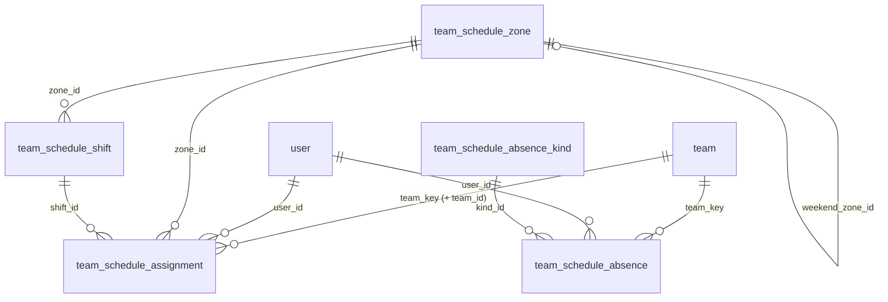

# Team Schedule — data model and deployment

The CRE and SRE rota behind the CSM portal's Team Schedule: who is working,
when, in which escalation tier, and who is away. Portal-native data with no
ServiceNow equivalent, so these tables are the system of record, not a mirror.

**Status:** code merged (#2032). Schema ships as migrations **0152–0156**.
Nothing else needs configuring: the routes are registered whenever
entity-service has a database.

## 1. The model at a glance



Three layers, one prefix. Every table is `team_schedule_*`. That keeps them
apart from `schedule`, `user_schedule` and `schedule_span` (0050), which mirror
ServiceNow's `cmn_schedule` tables and are unrelated to this.

| Layer | Table | One row is | Written by |
|---|---|---|---|
| Catalogue | `team_schedule_zone` | an SRE time zone (TZ1–TZ3) | migration 0154 |
| | `team_schedule_shift` | a named window of the day, e.g. "Evening 6-9pm", "TZ2 escalation" | migration 0154 |
| | `team_schedule_absence_kind` | a kind of time away, e.g. annual leave, Allo-EXT; `family` says which rota offers it | migration 0154 |
| Facts | `team_schedule_assignment` | one engineer, one rota day, one window | leads, via the portal; importers |
| | `team_schedule_absence` | a span of days an engineer is away | leads, via the portal; importers |
| History | `team_schedule_assignment_activity`, `team_schedule_absence_activity` | one change a lead made, as the portal's "Recent changes" shows it | entity-service |
| | `team_schedule_audit` | one row-level change to any state table, from triggers | Postgres |

Plus one column on a shared table: **`team.key`** (0152). This is the only change outside the prefix.

### Time: authored in one clock, read in any

A shift stores `start_minute`/`end_minute`, counted from midnight in its
`authoring_time_zone` (`Asia/Colombo`). An end past 1440 runs into the next
day, so 21:00–06:00 is one row, `1260 → 1800`. An assignment stores the
**resolved instants** `starts_at`/`ends_at`, computed when it is written. So
"who is on duty at 03:14 UTC" is one indexed range query, and it stays
correct across DST.

`rota_date` is the day the **crew** is rostered for. A Monday 21:00–06:00
block is Monday's, even though six of its hours fall on Tuesday.

### The rules the database enforces

| Rule | How |
|---|---|
| Nobody holds two turns at once | `team_schedule_assignment_no_overlap`: GiST exclusion on `(user_id, [starts_at, ends_at))` for turns only (`WHERE is_rotation`, copied from the window by trigger). Half-open, so 18:00 end and 18:00 start is a handover. A zone's regular hours may sit under a turn. |
| Nobody is away twice for two reasons | `team_schedule_absence_no_overlap`: exclusion on `(user_id, [starts_on, ends_on])`, closed at both ends |
| Same person, day and window only once | `team_schedule_assignment_unique_slot (user_id, rota_date, shift_id)` |
| An assignment cannot contradict its window | trigger `team_schedule_assignment_matches_shift`: where the shift fixes a zone or tier, the assignment must match it |
| A window carries at most one midnight | `end_minute <= start_minute + 1440` |
| Only SRE windows have a zone; escalation windows must | two CHECKs on `team_schedule_shift` |
| An assignment's `team_id` and `team_key` agree | composite FK to `team (id, key)` |
| A kind in use cannot be deleted | `kind_id … ON DELETE RESTRICT`. Retire a kind with `is_active = FALSE`. |
| Nobody works two sets of regular hours at once | `team_schedule_assignment_no_overlap_regular`: the same exclusion for regular hours (`WHERE NOT is_rotation`). TZ1's and TZ2's regular hours overlap, and CRE's regular and India-region windows are the same hours, so holding two would put one engineer in two places. A turn over regular hours is still allowed. |
| Deleting a user does not erase their rota | `user_id … ON DELETE RESTRICT` on assignments and absences. Users are deactivated, not deleted; a delete of someone with rota history is refused. |
| A used window's meaning cannot change under its rows | trigger `team_schedule_shift_guard_used`: while any assignment uses a shift, its hours, zone, tier, family and turn/regular flag are frozen (label, short code, colour, sort order, day scope and `is_active` stay editable). A correction is a new shift code, and the old one is retired. A migration that recomputes the rows itself may `SET LOCAL team_schedule.allow_shift_rewrite = 'on'`, as 0154 does. |

## 2. The catalogue (0154)

**SRE day**, as the leads run it:

| Zone | L1, L2 and L3 | Regular hours (SUP) | Weekend crew |
|---|---|---|---|
| TZ1 | 06:00–13:30 | 06:00–15:00 | TZ1+2, 06:00–21:00 |
| TZ2 | 13:30–21:00 | 12:00–21:00 | TZ1+2 |
| TZ3 | 21:00–06:00 | 21:00–06:00 | TZ3, 21:00–06:00 |

At the weekend TZ1 and TZ2 are one crew (`SRE_WE_TZ1`, drawn **TZ1+2**) and TZ3
runs as on a weekday: `SRE_TZ3` is `day_scope = 'ANY'`, and TZ3 is its own
weekend zone. An older database's weekend TZ2 window (`SRE_WE_TZ2`, standing in
for TZ3) is folded into `SRE_TZ3` by 0154, turns included.

**TZ3 is the SaaS night cover, one crew for every team.** Each night has one
TZ3 L1, L2 and L3 for the whole `SRE_SAAS` rota, whichever of Apollo or Artemis
each person is on. The pager calls the incident's own team's holder of a tier
when there is one and anyone on the rota otherwise, so with one holder per tier
an Apollo and an Artemis incident at night both reach the same L1 → L2 → L3.
"Generate month" builds the night that way, weekends included; TZ1, TZ2 and the
weekend TZ1+2 stay per team. The people who work the nights for months at a time
are moved onto the **SaaS Night cover** team (see below).

**CRE windows:** 6–9am (and its on-call), regular hours LK and IND, 6–9pm,
Americas cover, weekend rotation 06:00–21:00, and Americas weekend (and its
on-call).

Any tier, L1, L2 or L3, can be rostered in any zone. It goes on the zone's
window that fixes that tier where there is one (TZ1's and TZ2's own L1 windows),
otherwise on the zone's escalation window, which leaves the tier to the person.
Regular hours are drawn **SUP** (support in normal hours).

**Kinds of time away**, grouped by bucket:

| Bucket | Kinds |
|---|---|
| `LEAVE` | Annual (AL), Lieu (LL), Maternity (ML), Paternity (PL), Sick (SL) |
| `ALLOCATION` | Allo-INT, Allo-EXT, Brazil rotation (BR) on both rotas; RnD and SaaS Night cover (NC) on SRE only; Migration (Mig) on CRE only |
| `EXCLUDED` | Excluded from rota |

`team_schedule_absence_kind.family` is the rota a kind is offered on, and NULL
for both, which is every kind of leave. A lead's picker offers only the kinds
for the rota they are editing.

An allocation is a kind plus **`allocated_to`**, which says who the time is for
(the customer, or the product team for RnD). A new customer is a value, not a new
kind. Retired kinds stay in the table as `is_active = FALSE`: Customer on site,
Customer off site, Customer (unspecified), Onboarding and CRIS. The catalogue
still serves them, marked `retired`, so days already marked with one keep
their label; nothing offers them. On an older database 0154 moves customer
allocations to Allo-EXT, keeping `allocated_to`.

A weekday with nothing marked is a working day. The roster draws it as **LK**
(the CRE regular-hours code) without storing anything, and it gives way as
soon as leave, an allocation or a turn is marked. Weekends stay blank.

Re-running 0154 never overwrites a row a lead has since edited
(`ON CONFLICT DO NOTHING`).

### What a lead can do from the roster

A lead edits their own team's rows in the Month roster's cell picker:

- **Mark leave or an allocation over a span.** They choose a start and end
  date (both editable; the start defaults to the clicked day), then a kind.
  For an allocation there is an optional **For** field, which is stored as
  `allocated_to`. It is never stored with leave. The write is
  `POST /team-schedule/absences/apply`.
- **Roster L1, L2 or L3 in any zone.** For SRE the picker shows an
  escalation grid: every zone worked that day, with L1, L2 and L3 in each,
  not just the zone column that was clicked. The write is
  `POST /team-schedule/assignments/apply` with a `tier`.
- **Turns in more than one zone, and a turn on regular hours.** One engineer
  can be TZ1 L1 in the morning and TZ2 L2 in the afternoon, or on TZ1's
  regular hours (SUP) and TZ1 L1 the same day. Each kind of write replaces
  only its own kind:
  - a new escalation turn displaces only the turns in its own zone or that
    overlap it in time;
  - a zone's regular hours replace only the regular hours held that day;
  - a CRE window, or any window with no zone, still replaces the whole day.

  The roster stacks a turn over whatever it sits on (SUP or an allocation).
  Clearing a turn's cell, when the person holds anything else that day, takes
  off that zone's turn only (`zoneCode` on apply).
- **A tier is required on a zone's shared escalation window** (SRE_TZ1,
  SRE_TZ3, ...). A turn there with no tier is the zone's regular hours, which
  have their own window, and the views read any older tier-less turn that
  way.
- **Two tags in one day.** An allocation (RnD, customer) does not hide a
  rotation turn on the same day. The roster shows both: in the turn's own
  zone column on an SRE day, and stacked in the cell otherwise. Leave still
  takes the whole day, because someone on leave is not on the rota. In a cell
  holding both, **Clear** clears the turn, and the allocation has its own
  **Remove**.
- **Remove a whole span in one click.** Clicking any day of a leave or
  allocation shows the whole span with a **Remove** button, which deletes
  every day of it, including a span with no end date. The write is
  `DELETE /team-schedule/absences/{id}`. Clearing just a few days out of a
  span is still done with the date range and **Clear**.
- **Add a tag.** "+ New tag" adds a leave or allocation kind to the shared
  catalogue: a short code, a name, and a colour from the chip colours the rota
  already draws. The code is derived from the name. A name that is already
  used, or a short code another active kind already uses, is refused. Only
  team leads and rota admins may add a tag, and every team sees it once added. The write is
  `POST /team-schedule/absence-kinds`.
- **Delete a tag a lead added.** A custom tag carries a delete control, and
  deleting takes two clicks because the tag is shared by every team. A
  built-in tag cannot be deleted. A tag still used by any leave or allocation
  is refused, with how many entries use it, rather than retired quietly, which
  would leave those entries with no label or colour. The write is
  `DELETE /team-schedule/absence-kinds/{code}`.

Every write above is gated on the caller leading the team, or being a rota
admin for its group (for a removal, the team recorded on the absence row), and
each is recorded in the absence history and the audit table.

## 3. `team.key` — the one shared-table change (0152)

The rota lists every `team` whose `type` starts with `CRE` or `SRE`. It refers
to each of them by `team.key`, a lower-case handle: `apollo`, `castor`, and so on.

`team` is written by the ServiceNow sync, which knows nothing about `key`. So
0152 adds a **`BEFORE INSERT` trigger that fills `key` from the name** when a
writer leaves it out. Without that trigger the `NOT NULL` would reject every
sync insert that omits the column. That includes an `INSERT … ON CONFLICT DO
UPDATE` of a team that already exists, because Postgres checks the proposed row
before it resolves the conflict (tested). Once a row has a key, the key is never
rewritten, so renaming a team in ServiceNow does not move its rota history.

## 4. Deploying to a server

### Prerequisites

- **PostgreSQL 12 or later** (the schema uses a generated column).
- **`btree_gist` available.** 0153 runs `CREATE EXTENSION IF NOT EXISTS btree_gist`.
  It ships with Postgres, but a managed server may need it allow-listed first
  (Azure Database for PostgreSQL: add it to the `azure.extensions` server
  parameter). The migrating role needs permission to create extensions.
- **Team names unique ignoring case.** If they are not, 0152 stops before
  changing anything and names the clashing teams.
  ```sql
  SELECT lower(name), count(*) FROM team GROUP BY 1 HAVING count(*) > 1;   -- expect no rows
  ```

### Apply

The files are forward-only and safe to re-run. Apply them in order with
`make migrate` from `entity-service/`, which applies and records every file not
yet in `csm_migration_applied_migration`:

```bash
make migrate
```

Each file is its own transaction (`BEGIN` … `COMMIT`, like 0106 and 0114), so a
failure part-way leaves nothing behind, and sets `lock_timeout = '5s'`, so a
table another writer holds makes it fail fast instead of queuing that writer's
next statements behind it. 0152 matters most here: `team` is written by the
ServiceNow sync while it runs. After a lock timeout, re-run the file when the
table is quiet; it is safe to re-run.

Or apply them by hand, one `psql -f` per file (never `psql -1`, since each
file opens its own transaction), and record each one so a later
`make migrate` skips it:

```bash
psql "$DATABASE_URL" -c "CREATE TABLE IF NOT EXISTS csm_migration_applied_migration (filename TEXT PRIMARY KEY, applied_at TIMESTAMPTZ NOT NULL DEFAULT now())"
for f in 0152_team_add_key.sql 0153_team_schedule_tables.sql \
         0154_team_schedule_catalogue.sql 0155_team_schedule_audit.sql \
         0156_team_schedule_rota_admin_roles.sql; do
  psql "$DATABASE_URL" -v ON_ERROR_STOP=1 -f "migrations/$f" &&
  psql "$DATABASE_URL" -c "INSERT INTO csm_migration_applied_migration (filename) VALUES ('$f') ON CONFLICT DO NOTHING"
done
```

| File | Creates / changes | Touches shared tables |
|---|---|---|
| `0152_team_add_key.sql` | `team.key` + fill trigger + two unique constraints | **yes**: `team` |
| `0153_team_schedule_tables.sql` | `btree_gist`, 5 enums, 7 tables, indexes, constraints, the matches-shift and used-shift triggers | reads `team`, `"user"` (FKs only) |
| `0154_team_schedule_catalogue.sql` | 3 zones, 18 windows, 16 kinds | no |
| `0155_team_schedule_audit.sql` | `team_schedule_audit`, its trigger on 5 tables, one BASELINE row per existing row | no |
| `0156_team_schedule_rota_admin_roles.sql` | the `cre_rota_admin` / `sre_rota_admin` roles | **yes**: `role` (seeded by name, `ON CONFLICT (name)`) |

### Rota admins (0156)

A lead edits their own team's rota only. A **rota admin** may edit every team
of one group, so a rota can still be fixed while its lead is away. It is a
role, `cre_rota_admin` or `sre_rota_admin`, one per group; someone who runs
both is granted both. The write check is "a lead of this team, or a rota admin
for its group" (`requireRotaWriter`), and a row still belongs to the team it
is filed under.

**A rota admin is internal staff first.** The role is a schedule permission,
not a way to become internal: `recompute_user_type()` is untouched, so it
still derives `user_type = INTERNAL` from the `admin` and `internal` roles
alone. The schedule refuses any caller who is not INTERNAL, and counts the
rota admin role only on an INTERNAL holder, so granting it to anyone else
(a customer, by mistake) does nothing at all. It never widens what they can
reach elsewhere on the platform.

In the portal a rota admin reads their own group's views as an engineer does,
and the other group's Today only. The page learns the group from the teams
they may edit, since the sign-in token does not carry these roles.

**Granting is a deployment step, not a migration**: who runs each rota differs
per environment. A CSM admin grants and removes it on the Team Schedule's
**Rota access** tab (0225, see "Rota access" below). Without the portal, a
grant is a row in `user_role`, given to someone who already holds `internal`
or `admin`:

```sql
INSERT INTO user_role (id, created_on, updated_on, created_by, updated_by, user_id, role_id)
SELECT gen_random_uuid(), now(), now(), 'admin', 'admin', u.id, r.id
  FROM "user" u, role r
 WHERE lower(u.email) = lower('jane.doe@example.com') AND r.name = 'cre_rota_admin';
```

### A server that ran the old file names

Before this schema was renumbered it shipped as `000088`–`000104`, in the old
`.up.sql`/`.down.sql` format. `make migrate` picks up both halves of those
files, and they sort ahead of `0001`. On a server that ran it in that window,
the first two old files applied and the third failed, leaving
`schedule_zone`/`_shift`/`_assignment`/`_absence` under their pre-rename names.
0153 detects that state and drops those four tables, which can only hold
catalogue rows, before building the real ones. If any assignment or absence rows
exist, it refuses and changes nothing. The four old filenames left in
`csm_migration_applied_migration` are harmless.

### Check it worked

```sql
-- 18 windows, 16 kinds (11 active), 3 zones; both rota admin roles present
SELECT (SELECT count(*) FROM team_schedule_shift)                         AS shifts,
       (SELECT count(*) FROM team_schedule_absence_kind WHERE is_active)  AS active_kinds,
       (SELECT count(*) FROM team_schedule_zone)                          AS zones;

-- The teams the rota will show. Empty means nobody will see a rota:
-- the ABT teams need a type beginning CRE or SRE (e.g. CRE-ABT, SRE-ABT).
SELECT key, name, type FROM team
 WHERE lower(type) LIKE ANY (ARRAY['cre%', 'sre%']) ORDER BY type, name;
```

Then open Team Schedule in the portal. The day view renders its bands from
the catalogue whether or not anyone is rostered yet.

### Rollback

There is no down migration. To remove the feature's schema entirely (this
destroys every rota row):

```sql
DROP TABLE IF EXISTS team_schedule_audit, team_schedule_assignment_activity,
  team_schedule_absence_activity, team_schedule_assignment, team_schedule_absence,
  team_schedule_shift, team_schedule_absence_kind, team_schedule_zone CASCADE;
DROP TYPE IF EXISTS team_schedule_shift_family_enum, team_schedule_tier_enum,
  team_schedule_day_scope_enum, team_schedule_source_enum, team_schedule_absence_bucket_enum;
DROP FUNCTION IF EXISTS team_schedule_assignment_matches_shift(), team_schedule_shift_guard_used(),
  team_schedule_audit_row();
-- team.key is shared; leave it unless nothing else has started using it.
```

## Rotas: IaaS SRE and the SME rotations (0199–0200)

A **rota** is a named rotation inside a family. SRE runs SaaS (Apollo & Artemis)
and IaaS. **SME**, a third family added in 0199, runs one rota per product:
Asgardeo, Choreo Runtime, Bijira, Devant, WSO2 Cloud · Agent platform,
WSO2 Cloud · Core and Moesif, plus U2 and B-Central (0217). The source is the "CSM SRE + SME on call" doc.
PaaS SRE is N/A there, so it has no rota until it has a schedule.

| Rota | Family | Team type | Zones (LK time) | Duty rotates | Escalation |
|---|---|---|---|---|---|
| `SRE_SAAS` | SRE | `sre-abt` | TZ1, TZ2, TZ3 (unchanged) | irregular | 5 min |
| `SRE_IAAS` | SRE | `sre-iaas` | `IAAS_D` 08:00–20:00 · `IAAS_N` 20:00–08:00 | daily | 5 min |
| `SME_ASGARDEO` | SME | `sme-asgardeo` | `ASG_D` 09:30–18:30 · `ASG_N` 18:30–09:30 | daily | 5 min |
| `SME_CHOREO` | SME | `sme-choreo-runtime` | `CRT_D` 06:00–18:00 · `CRT_N` 18:00–06:00 | weekly | — |
| `SME_BIJIRA` | SME | `sme-bijira` | `BIJ_D` / `BIJ_N`, as Choreo Runtime | weekly | — |
| `SME_DEVANT` | SME | `sme-devant` | `DVT_D` / `DVT_N`, as Choreo Runtime | weekly | — |
| `SME_CLOUD_AGENT` | SME | `sme-cloud-agent` | `WCA_D` 06:00–18:00 · `WCA_N` 18:00–06:00 | weekly | 5 min |
| `SME_CLOUD_CORE` | SME | `sme-cloud-core` | `WCC_D` / `WCC_N`, as Agent platform | weekly | 5 min |
| `SME_MOESIF` | SME | `sme-moesif` | `MOE_D` 10:00–22:00 · `MOE_N` 22:00–10:00 | weekly | 30 min |
| `SME_U2` | SME | `sme-u2` | `U2_D` 06:00–18:00 · `U2_N` 18:00–06:00 (0236) | weekly | 5 min |
| `SME_B_CENTRAL` | SME | `sme-b-central` | `BCN_D` / `BCN_N`, as U2 | weekly | 5 min |

U2 and B-Central were added by migration 0217, data only, with the windows their rota sheet gives. Unlike the other SME rotations it also inserts their two team rows (keys `u2`, `b-central`), only when no team has that key, so every environment gets them from one script.

Migration 0236 corrected both to Day 06:00–18:00 and Night 18:00–06:00 (from 0217's 10:00–22:00 / 22:00–10:00), for all time: those were never their hours. It changes the four windows in place (same codes, zones, labels and colours) and resolves every turn on them again, past turns included, in the same transaction -- the one case the used-shift guard (0153) allows a used window's hours to change, as 0154 did. The turns are first parked a minute apart far ahead, because the same engineers hold day and night and the row-by-row no-overlap check would otherwise trip mid-update. A turn whose new hours overlap the same engineer's turn on another rota keeps its old instants and is named in a NOTICE.

Migration 0235 does the same for the other seven SME rotations' teams (keys `asgardeo`, `choreo-runtime`, `bijira`, `devant`, `cloud-agent`, `cloud-core`, `moesif`, with the names and types the local seed uses). They never arrive from the ServiceNow sync, so without them a deployed SME rota has nobody to roster and an escalation to Special Ops pages nobody (the SME page finds no team for SPECIALIST_HANDOFF_CONFIG's `smeTeam`). It also adds IaaS's team (key `iaas`, type `sre-iaas`, as production has it), which a database that did not get it from production lacks, leaving the IaaS rota with no team. A key already held by a team of another type is left alone and named in a NOTICE.

**How it hangs together:**
- **Teams join a rota by type.** A team is on the rota whose `team_type` matches
  `team.type`, read the same way the family always has been
  (`sme…` → SME, `sre…` → SRE). No column is added to `team`: to put a team on a
  rota, give it the rota's type. The ServiceNow sync writes the team rows it
  knows; the SME rotations' teams, which it does not, come from migrations
  0217 and 0235 (which also adds IaaS's, where it is missing). On a local stack, `scripts/csm-compose/seed-team-schedule-rotas.sql`
  adds one team per new rota.
- **Zones belong to rotas.** `team_schedule_zone.rota_id` (nullable) ties each
  zone to its rota. TZ1–TZ3 are backfilled to `SRE_SAAS`; a zone without a rota
  still works as before.
- **Windows.** Each new zone has one escalation window, worked every day
  (`ANY`), with the tier (L1, L2 or L3) on the assignment, as `SRE_TZ3` does.
  The weekend is the same as the weekdays.
- **Who may edit.** `sme_rota_admin` does for SME what `cre_rota_admin` and
  `sre_rota_admin` do for their families. Granting it stays a deployment step.
- **The catalogue** gains `rotas[]`, `zone.rotaCode` and `team.rotaCode`. All are
  additive; a client that ignores them sees what it saw before. The webapp
  scopes every view to one rota and offers a rota picker only where a family
  has more than one rota with teams, so CRE and SaaS-only SRE read as before.

**IaaS windows started inactive; `0231` switches them on.** The portal before
this change read every zoned SRE window as part of SaaS's day, week and
roster. `0200` therefore seeded `SRE_IAAS_DAY` and `SRE_IAAS_NIGHT` with
`is_active = FALSE`, so an older webapp still running during the deploy never
saw them, and left switching them on as a manual step. That step was never
run: the catalogue serves only active windows, so an IaaS lead's roster cell
offered leave and allocations and nothing on the Rota side. `0231` now
switches them on, and the local seed no longer does it on its own.

SME's windows ship active: the older portal knows only CRE and SRE and passes
them by.

**Not changed, on purpose:**
- **`rota.escalation_minutes` is informational.** The escalation ladder
  (csm-notification-service) keeps its own timing.
- **The notification service only runs the CRE ladder.** Its rota rungs are
  scoped by team type and key, so the new teams never reach it. An SRE or SME
  ladder is separate work.

## The SaaS Night cover (0232)

The SaaS night (TZ3, 21:00–06:00 LK) is worked by a few Apollo and Artemis
engineers who go onto it for three to six months and then come back. 0232 makes
that a team, the way the Americas team is one for CRE:

- **The team**, `saas-night-cover` ("SaaS Night cover"), typed `sre-abt`, so it
  is on the `SRE_SAAS` rota beside Apollo and Artemis. Nobody is a member: the
  people on it stay members of their own team.
- **The tag**, `SRE_NIGHT_COVER` "SaaS Night cover", SRE only, which moves
  somebody onto the team for a span (`moves_to_team_key`, worked there). It
  has no hours of its own (`shows_as_shift_code` is NULL): being on the team
  is the whole of it, and L1, L2 and L3 stay turns on `SRE_TZ3`, still one
  crew for the whole rota, and only those page. A lead marks it from the
  person's own row (**Move to SaaS Night cover**, with 3 / 6 month shortcuts
  for the end date) and ends it with **Back to Apollo**; the roster lists the
  person under the Night cover while the move lasts, with only their turns on
  the days, and under their own team after it.

What a move does, beyond what a Brazil rotation does (both rotas' rules are in
the schedule repository). A move between two teams of one rota is a move: the
person is on the Night cover for those days and nowhere else.

- **What they held on their own team over the move goes** -- day turns and
  regular hours, whoever set them -- each removal recorded in the history
  (`clearHomeTeamOver`). The slots it frees are left empty for a lead, and
  Case Paging readiness lists them.
- **Their TZ3 nights go with them**: a TZ3 turn on a night the move covers is
  filed under the Night cover, and so is any turn set for them on those days
  later, even from their own team's row (`fileTurnsWhereTheyAre`). If the move
  is cut short, what is left on the days it no longer covers goes back to their
  own team. Who is paged does not change -- the TZ3 crew is the rota's -- but
  everything of theirs is drawn, and cleared, on the one row they are on, and
  no view lists them on two teams.
- **It is not time away from the rota.** The pager's on-duty read and Case
  Paging's readiness treat a move to a team of the same rota as no absence at
  all, so a TZ3 night that starts the evening before the move and runs into
  it still pages them.
- **Their own team's lead keeps rostering them** (the Night cover has no lead):
  `TeamsShareRota` lets the home lead set turns on the Night cover's row, as
  well as end the move. Another team's lead cannot. Remove on the move, or on
  leave marked inside it, is the home lead's too (this also fixes Remove for
  the Brazil rotation).

**Generate month** takes the month's TZ3 crew from the Night cover when nobody
is chosen: everybody a move covers on a day of the month, working TZ3 only
while it lasts (a day of the month it does not cover is left for a lead). Their
nights are filed under the Night cover, and they get no regular hours on those
days. Lieu leave earned on the Night cover cuts the move for those days, as
leave a lead marks does, and regenerating without that lieu joins the move up
again. The portal's Generate month dialog no longer picks TZ3 people: it lists
who is on the Night cover that month.

## Who may read and change each family

There are three rota admins, one per family: `cre_rota_admin`, `sre_rota_admin`
and `sme_rota_admin`. No schema change: the family of a team is read from
`team.type`, as everywhere else.

| Role (in CRE, SRE or SME) | Reads | Writes, updates, deletes |
|---|---|---|
| Engineer | every family | nothing |
| Rota marker | every family | their own team's rotations, leave and allocations |
| Team lead | every family | their own team |
| Rota admin | every family | their own family's teams |
| CRE head, CS head | every family | every CRE team, as a CRE rota admin |

- **The CRE head and the CS head** (team position `cre_head` / `cs_head` on
  any team, internal staff) count as CRE rota admins without holding the role:
  every CRE team's rota, the CRE tags, CRE's rota markers on Rota access, and
  on Case Paging the responders and Team leads of every CRE team. Who holds a
  position -- the America lead, Americas Team leads, the CRE and CS heads --
  keeps its own rules (a CRE rota admin or the portal admin), so a head cannot
  appoint the head above them. Neither runs an SRE or SME rota by being a head.
- **Reads are not limited by family**, for anyone: the catalogue, turns, leave,
  on-duty, edit markers and every Case Paging chain.
- **Writes** go through `requireRotaWriter`: a lead edits their own team, a rota
  admin the teams of their family, a rota marker their own team.
- **A rota marker is not a lead.** The tags, Generate month, Case Paging and
  paging numbers keep their own rules, which do not include a marker.
- **Absence kinds** (`schedule_tag_family.go`): a kind a rota admin adds is
  stored for their family (`team_schedule_absence_kind.family`), and they may
  delete only their own family's custom kinds. A team lead who is no rota admin
  adds shared kinds, as before.

## Rota access (0225)

The Team Schedule's **Rota access** tab, next to Case Paging, is where rota
admins and rota markers are granted and taken back.

- **Rota admin** (`cre_rota_admin`, `sre_rota_admin`, `sme_rota_admin`, stored
  in `user_role`): edits every team in one family. Granted and removed by a
  **CSM admin** only.
- **Rota marker** (`team_schedule_rota_marker`, one row per person and team):
  marks one team's rotations, leave and allocations, and nothing else. Granted
  and removed by a CSM admin for any team, or by a family's rota admin for that
  family's teams. Only a member of the team can be named, and the grant stops
  counting the moment they leave the team or stop being internal staff; the tab
  then lists it as inactive so it can be removed.
- **A CSM admin is the CSM Portal admin**: a caller whose token's `roles` claim
  holds one of `AUTH_ADMIN_ROLES`, matched exactly. It is the same variable,
  with the same value, that csm-portal-backend reads; entity-service reads it
  too, so set it on both. Nothing about how the portal uses it changes, and the
  portal still gates the rota admin routes with `PermAdmin`.
- **Only active internal staff** can be granted either, as before for rota
  admins: a grant to anyone else is refused rather than stored.
- **Audited.** Every grant and removal is in `team_schedule_audit`, with the
  caller as actor: the marker table through the usual trigger, and `user_role`
  through a trigger that records only the three rota admin roles.
- `GET /team-schedule/my-lead-teams` also returns `markerOnlyTeamKeys`, the
  teams held only as marker, so the page offers Generate month, the tags and
  Case Paging only where the reader leads the team or runs its family.

## Case Alerts settings (0233)

The chat rooms, the ServiceNow group routes and the rest of the paging
ladders' settings can be kept here and changed on the Alert Settings tab, instead
of a Choreo secret and csm-notification-service's YAML file mount. Only what
decides whether paging runs and what it may cost -- the switches, the channel,
the safety caps, `phones.source`, test calls and the SME page -- stays in the
file (`scripts/csm-compose/paging-alert.minimal.yaml` is that small file).
**Each family's settings are its own** (0237, 0238): CRE's chat room,
redirects and ladder values; SRE's team rooms, redirects and ladder values;
SME's team rooms and ladder values (timing, teams, on leave, closing message).
With `PAGING_CONFIG_SOURCE` unset csm-notification-service uses everything
saved, over the file's, at its next start; what is not saved keeps the file's,
so nothing changes until somebody saves. `off` uses none of it. No setting is
needed on either service. A saved SME room is used even when the file lists no
SME rooms (`sme.teamChats`); every SME team without one keeps `sme.chat`.

- **Rooms** (`paging_chat_room`), shown as *Team routing*: the CRE and SRE
  shared rooms, an SRE team's own row (Apollo, Artemis, IaaS) and, since 0237,
  an SME team's (no shared SME room, teamless or channel). A team row
  may be marked *teamless* (it also gets the cards of an incident with no SRE
  team), and may set how that team's alerts go out: chat, call, both or log.
  A team never does more than its ladder -- the ladder's channel stays in the
  alert service's file and is the ceiling -- and a row can hold a channel
  without a URL of its own.
- **Webhook URLs** (`paging_chat_secret.webhook_url`) are write-only and, since
  0237, stored as saved: no key is needed. People see a hint (space id and the
  token's last characters); the URL never reaches a browser, a log or the audit
  history -- that table has no audit trigger. Anyone who can read the database
  or a copy of it can read the URLs and post into those spaces; accepted, the
  database being internal. A URL sealed before 0237 opens only where
  `CASE_ALERTS_SECRET_KEY` is set, and saving it again stores it plainly.
- **Routes** (`paging_group_route`): a ServiceNow group to a team, or (SRE) a
  default group to a rota such as `SRE_SAAS`.
- **Ladder values** (`paging_ladder_value`): one row per other key of the file's
  `cre:` or `sre:` section -- the teams (`teams.abts`, `teams.americas`, ...),
  the heads (name and email; the phone comes from their profile), which
  incidents start a ladder (`trigger.*`), how it climbs (`alertDuty.*`,
  `onLeave`, ...) and the SRE clock (`timing.*`), as JSON in the file's shape.
  Each key has its limits (for example `timing.interval` 1m to 30m), checked on
  save; a set of values is saved together or not at all. The list is
  `caseAlertValueSpecs` in `internal/service/case_alert_ladder_values.go`, and
  csm-notification-service's `caseAlertKeys` must match it.
- **What is in use:** in shadow or db mode the alert service reports each
  ladder value it runs with and whether it came from the file or from here. The
  tab shows it next to what is saved, and *Copy what's in use* saves the file's
  values here in one go -- the first step of moving to the small file. What
  only the file sets (on/off, channel, safety caps, where numbers come from) is
  reported too and shown read-only; allowed numbers as a count only.
- **Who:** seeing a family's settings and changing them go together, and
  another family's are never sent. CRE: the CRE rota admin and the CRE and CS
  heads. SRE (SaaS and IaaS): the SRE rota admin. SME: the SME rota admin. A CSM
  admin (`AUTH_ADMIN_ROLES`) or portal admin, or anybody with all three rota
  admin roles: all three. Team leads see who gets alerts, not the settings.
- **Test card:** entity-service posts a short card to the saved URL and records
  delivered or failed; one per room every two minutes. entity-service needs to
  reach `chat.googleapis.com` for this.
- **csm-notification-service** reads `GET /team-schedule/case-alerts/settings/runtime`
  (any internal service client; `CASE_ALERTS_RUNTIME_CLIENT_IDS`, when set,
  narrows it; a person's token is refused) at start-up only, and reports what
  it loaded on `PUT .../applied`.
  `paging_config_revision` tells "saved" from "running".
- **Audited:** room, route and ladder value changes go to `team_schedule_audit`
  with the caller as actor.

Settings on entity-service, all optional: `CASE_ALERTS_ENVIRONMENT` (a label
such as `staging`), `CASE_ALERTS_RUNTIME_CLIENT_IDS` (narrows who may read the
URLs), and `CASE_ALERTS_SECRET_KEY` / `_KEY_ID` (only to open a URL sealed
before 0237).

## 5. Known gaps

- **Why 0152–0156.** 0141–0150 are claimed by the open RLS work in #2094, and
  upstream's 0151 already sits after that range, so these follow it. The
  numbers have not been checked against `operations/csm-sync-service`, which
  owns `team` and `role`; confirm 0152 and 0156 are free there before
  production.
- **The sync must never need to change `team.key`.** It cannot today, because
  it does not know the column exists. If it ever writes `key`, that value wins
  over the trigger.
- **`team_schedule_audit.changed_at`** breaks the `_on` suffix convention.
  entity-service reads the column by that name, so renaming it is a code
  change as well as a migration.

## Change log

- **0238 Case Alerts: SME ladder values.** `paging_ladder_value` takes ladder
  `SME`. Additive and re-runnable; no row changes.
- **0237 Case Alerts: SME team rooms, plain URLs.** `paging_chat_room` takes
  ladder `SME` (team rooms only); `paging_chat_secret` gains `webhook_url`, and
  its sealed columns become optional. Additive and re-runnable; no row changes.

- **0233 Case Alerts settings.** New tables `paging_chat_room`,
  `paging_chat_secret`, `paging_group_route`, `paging_ladder_value` and
  `paging_config_revision` (one row), audit triggers on the room, route and
  value tables, and a trigger that moves the revision on any change. Additive: nothing existing is changed or
  removed, and csm-notification-service ignores them until
  `PAGING_CONFIG_SOURCE` is set.
- **0232 SaaS Night cover.** Data only: the team `saas-night-cover` (type
  `sre-abt`) and the tag `SRE_NIGHT_COVER` that moves somebody onto it. Nobody is moved by the migration; leads move their night
  people from the roster, and the TZ3 nights already set inside a move go with
  it. Re-runnable.
- **0225 rota access.** New table `team_schedule_rota_marker` (with an index on
  `team_key`) and its audit trigger; a second audit trigger on `user_role` that
  records only the rota admin roles. Additive: nothing existing is changed or
  removed. entity-service now also reads `AUTH_ADMIN_ROLES` (same value as
  csm-portal-backend's).
- **`excludeAbsent` on the rota search.** `POST /team-schedule/assignments/search` takes `excludeAbsent: true` to leave out anyone away on the assignment's rota day, by the rule `/team-schedule/on-duty` uses (every absence kind counts; a span that moves somebody to another team does not count against that team's shifts). The on-duty lookup (both its modes) and this search read one SQL fragment (`absenceOn` in `schedule_repo.go`), so the reminder emails and the pager cannot disagree about who is working. Off by default: the rota views draw leave over the rota. No schema change. Its caller is csm-scheduled-tasks' rota reminders (`rota_weekday_reminder`, `rota_weekend_notice`); an entity-service without the field refuses it (unknown field, 400), so deploy entity-service first.

- **0199–0200 rotas.** The SME family; `team_schedule_rota`; `zone.rota_id` (TZ1–TZ3 on `SRE_SAAS`); the zone-family check widened from SRE to SRE or SME; IaaS and seven SME rotas, each with a Day and a Night zone and window; the `sme_rota_admin` role. Nothing is removed, renamed or re-typed, but existing objects do change: 0199 adds a value to `team_schedule_shift_family_enum`; 0200 adds the nullable column `team_schedule_zone.rota_id` and sets it on the existing TZ1–TZ3 rows, and replaces the zone-family CHECK with a wider one (every existing row satisfies it). IaaS's two windows are seeded inactive until the new webapp is deployed.
- **0223 shared windows.** `team_schedule_shift.shared_across_teams` (BOOLEAN, default FALSE), TRUE for `SRE_TZ3` only: its tiers are one crew for the whole SaaS rota. `POST /team-schedule/assignments/apply` refuses (409, naming the holder) an SRE tier somebody else already holds on that zone and day -- per team, or across the rota on a shared window. Additive only; no constraint is added, since data written before it may already hold two people on one tier.
- **0152–0155** replace `000088`–`000107`, which were written in the old
  up/down format. They reproduce the schema and catalogue that chain ended in
  exactly (compared with `pg_dump` against a server built from the old chain).
  They also add the `team.key` fill trigger. The old files are gone; nothing
  should apply them.
- **Weekend and kinds, same PR.** The SRE weekend is TZ1+2 by day and TZ3 by
  night (was weekend TZ1 and a weekend TZ2 for the night). Absence kinds gained
  `family`; Allo-INT and Allo-EXT are offered again, and the customer
  allocations and Onboarding are retired. 0153 and 0154 bring an older
  database to both, and re-running them changes nothing.
- **Review of #2109.** The rota admin role no longer makes anyone INTERNAL: the
  migration that added it to `recompute_user_type()` is gone, and only an
  INTERNAL holder counts. Each file is one transaction with a 5s lock timeout.
  Rota history survives a user delete (`RESTRICT`), regular hours cannot
  overlap, and a used shift's meaning is frozen. The day view's overnight
  lookup reads only the day before, on the `rota_date` index.
