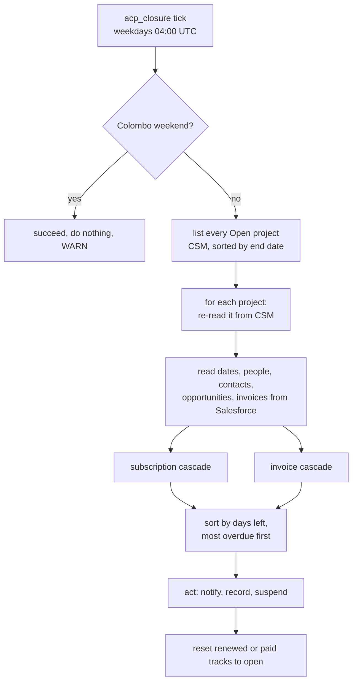

# ACP closure — how the sweep works

The Account Closure Process (ACP) as it runs in `csm-scheduled-tasks`: the
`acp_closure` sub-cron that warns customers before a project's subscription end
date or an unpaid invoice's suspend date, and suspends the project when the date
arrives. This page explains the run end to end. The operational settings and
review history live in the component's `CLAUDE.md` ("ACP closure"); the code is
in `internal/acp/`. The other sub-crons are covered in
[sub-crons.md](sub-crons.md).

**Status:** `acp_closure` replaces `integrations/acp-closure-service`, which is
frozen (it refuses to start unless it is a log-only dry run) and is deleted once
this task runs in production. Rule changes go to `internal/acp` only. The task
is off unless `ACP_ENABLED=true` and is a dry run unless `ACP_DRY_RUN=false`.

## 1. A run at a glance

One invocation is one sweep. There is no long-running process: the platform
trigger supplies the cadence and the engine retries a failed run (section 7).

### Two systems, two jobs

| System | What ACP reads | What ACP writes |
|---|---|---|
| CSM (entity-service) | The list of Open projects, each project's closure states and `suspensionProcessState` (the record of notices sent) | Notice records; the closure state and suspension record (`PATCH /projects/{id}`) |
| Salesforce (sales-entity-service) | Project dates, account owner, renewal manager and technical owner, contacts, partner status, opportunities, invoices | `State__c = Suspended` on a suspension |

The two are written by ACP itself. Nothing syncs CSM to Salesforce.

## 2. The decision: one cascade, two anchors

Every cascade counts the days between now and an **anchor date** and fires on the
same thresholds: **90, 60, 30, 15, 7 and 0**.

| Cascade | Anchor date | Its own record of progress |
|---|---|---|
| Subscription end date | The project's end date | `based_on_subscription_end_date` in `suspensionProcessState` |
| Unpaid invoice | The invoice's suspend date (below) | `based_on_due_invoices` in `suspensionProcessState` |

The two cascades are independent: separate state, separate closure-state
dimension (`endDateClosureState`, `invoiceDueDateClosureState`).

How a cascade decides (`internal/acp/closure/decide.go`):

- Days remaining are rounded **up**, so a project is never treated as further
  out than it is.
- **Below 0 days** (the day after the date): fire the day-0 window. Notify if no
  day-0 notice is recorded, and suspend. On the date itself (0 days) the project
  is still in the 7-day window and is not suspended. Suspension has no idempotency of its own here: the
  caller checks the closure state.
- **Otherwise** the narrowest window already reached and not yet recorded. Windows
  are thresholds, not exact days: a project that reaches 10 days with nothing
  recorded gets the 15-day notice, not the 7-day one, and the 7-day one when it
  reaches 7. Only the narrowest window reached is sent. Notices are never
  caught up after a pause.

### The invoice anchor

Only invoices that count are considered (`invoice_resolve.go`):

- The invoice's opportunity is `50 - Closed Won` and its EULA field is set and not
  `Customer contract`.
- The invoice has a due date, is unpaid, is not an excluded classification, is not
  the `Auto Created PS` placeholder, and is due on or after the project's start date.

The cascade is driven by the one eligible invoice with the **earliest due date**, not the earliest suspend date. With differing grace periods another invoice can have an earlier suspend date and still not drive the cascade. The suspend date of that invoice (`decide_invoice.go`):

| Case | Suspend date |
|---|---|
| EULA 3.4 or later, no primary partner | The invoice due date |
| EULA 3.3 or earlier, or the account has a primary partner (the 60-day grace period) | Invoice date + 60 days, unless the credit period (due minus invoice date) is already longer than 60 days, then the due date |

An account that is a partner **without** a primary partner skips the invoice
cascade entirely. An unset EULA version (0) never triggers the grace period on
its own.

## 3. Acting on a decision

Both cascades are built first, then run **most overdue first** (stable, so a tie
keeps the subscription cascade ahead of the invoice one). Once one cascade
suspends the project, the later cascade skips its **email**: the "already closed"
flag is tracked in memory, because a read of the project right after a write is
not guaranteed to show it.

Per cascade, in order, and a failure stops that project:

1. **Probe the record write.** The project's `suspensionProcessState` is written
   back unchanged. If CSM refuses it for the project's own reason (400, 404, 409,
   422) nothing is sent and the project is skipped. Without this, a project CSM
   refuses to record would get the same notice every weekday.
2. **Notify.** Send the notice for the window (section 4). An error stops the
   project before any suspension.
3. **Record the notice** in the cascade's section of `suspensionProcessState`:
   `actionSendEmailNotification` is `SUCCESSFUL` if delivered, `IGNORED` if not
   (for instance, every recipient was filtered out).
4. **Suspend**, on the day-0 window only, the day after the date (section 5).

Each record write replaces the whole `suspensionProcessState`, so each cascade
builds on the previous cascade's write, not on the snapshot read at the start.
Building both from the snapshot once let the second cascade reset the first one's
section.

### Renewal reset

After the cascades, a track whose own closure state is still Open and whose date
has **moved out past its recorded window** (more days remain than the recorded
window's day count: 90, 60, 30, 15 or 7, and 0 for a recorded day-0 or suspend
record) has its saved `event_type` set back to `open`, so the next term's
reminders start over. That covers a renewal, an extended end date or due date, a
paid invoice, and a hand-reopened project whose date is in the future again. A
date at the recorded window's day count or below is left alone (no rewrite on
every run). The next run then sends the window that is due. It never
changes a closure state: reopening a suspended project is not done here
(section 8).

## 4. Notices

| Window | Internal (account owner, renewal manager, technical owner) | Customer |
|---|---|---|
| 90, 60, 30 | Yes | No |
| 15, 7, 0 | Yes | Yes |

- **Internal** subjects are `[ACP]`-prefixed: `[ACP] N Days Reminder of Project
  for <project> of <account>` and `[ACP] Project Suspension Notice of ...` on
  day 0. The invoice cascade uses invoice wording and lists every due invoice.
- **Customer** notices are never `[ACP]`-prefixed and never name the account.
  Future tense before day 0 (`Upcoming Project Suspension Notice`), past tense
  after. The invoice cascade sends a `Payment Reminder` instead.
- **Customer recipients** are the project's `BUSINESS_CONTACT` contacts with a well-formed email. With none,
  the account's primary contacts. With neither, no customer notice goes out and an
  `[Urgent] [ACP] No Business Contacts Specified` nudge goes to the internal
  recipients instead.
- **Standing lists** (`ACP_STANDING_CC_RECIPIENTS`) are added to every notice.
  Leave them empty outside production. A customer notice that reaches only the
  standing lists is not counted as delivered.
- **Recipient filter**: addresses outside `@wso2.com` are dropped unless
  `ACP_ALLOW_NON_WSO2_RECIPIENTS=true` (production only). With no `to` left, the
  send is skipped.

## 5. Suspension

Suspension runs only if that cascade's own closure state is still Open, and writes
in this order:

1. **Salesforce first**: `State__c = Suspended`.
2. **One CSM `PATCH`**: the closure field and the suspension's record together.

| Cascade | Closure field written | Record written |
|---|---|---|
| Subscription end date | `endDateClosureState = Closed` | `event_type: suspend`, `suspended_on: <Colombo date>` |
| Invoice | `invoiceDueDateClosureState = Suspended` | the same, in the invoice section |

The day-0 notice is recorded as `suspend_notice`, which reads as window 0. A retry
therefore sends no second notice and only retries the suspension. `suspend` is
**never** written on its own: an Open project carrying a `suspend` record is how
entity-service's reopen recognises "a person set it back to Open", so writing it
early would reopen a project that was never suspended.

Consequences of the order:

- A Salesforce failure leaves CSM Open with `suspend_notice` only, and Salesforce
  untouched. The next run retries.
- A CSM failure after Salesforce succeeded leaves Salesforce Suspended and CSM
  Open until the next run retries (the Salesforce write is repeated, then the
  CSM one).

## 6. Safety switches

| Setting | Default | Effect |
|---|---|---|
| `ACP_ENABLED` | off | The task is not registered and no `ACP_*` setting is read |
| `ACP_DRY_RUN` | true (unset or malformed too) | Decide and log. Nothing written to CSM or Salesforce |
| `ACP_EMAIL_SEND_ENABLED` | false | Notices are only logged |
| `ACP_TEST_PROJECT_ID` | unset | Scope the run to one project |
| `ACP_EXCLUDED_PROJECT_IDS` | empty | Skip listed projects entirely. For verified business exclusions only, not for data bugs |

Startup refuses combinations that would harm customers:

| Combination | Why it is refused |
|---|---|
| `ACP_DRY_RUN=false` without `ACP_EMAIL_SEND_ENABLED=true` | It would record notices nobody received and suspend customers who were never told. `acp.Run` refuses it again as a last guard |
| Dry run **with** emails on and no `debug` list | A dry run records nothing, so every run would resend every due notice |
| A `debug` list with `ACP_DRY_RUN=false` and no `ACP_TEST_PROJECT_ID` | Notices would reach only the testers while every project is recorded and suspended |

`ALERTS_ENABLED=false` turns the task into a dry run without emails instead of
refusing. A `debug` list for `acp_closure` in `SUB_CRON_RECIPIENTS` sends every
notice there as a `[Test copy]`.

## 7. Failures, retries and weekends

- **Fresh read.** Every open project is listed first, then re-read from CSM right
  before it is decided. A listing can be as old as the run, and every record write
  sends the whole state, so deciding from the listing could undo a concurrent
  change. The write is not conditional: entity-service has no version check on
  `PATCH /projects/{id}`.
- **One project failing** does not stop the others, with one exception: a CSM
  write failure every project would hit (401, 403, 429, 5xx or no response) stops
  the run, since notices go out before they are recorded and carrying on would
  resend every one next time.
- **A project with an unusable record** (no Salesforce id, one Salesforce does not
  have, an unparseable date) is **skipped** with a warning and does not fail the
  run. No retry can fix it, and failing would alert every weekday.
- **A customer-window notice can half-succeed.** At 15, 7 and 0 days the internal notice and the customer notice are separate sends. If the internal one is delivered and the customer one fails, the record write is never attempted, so a retry sends the internal notice again.
- **Any other failure** makes the run return an error naming the run id and at
  most 20 project ids (never their errors, which can hold customer data). The
  engine alerts and retries after 4 hours, at most once a day (`MaxAttempts` 2).
  A retry repeats nothing already recorded, except a notice whose email went out
  while its record write failed, which is sent again.
- **Weekends.** The schedule is weekdays only. The handler also succeeds without
  doing anything on a Colombo Saturday or Sunday (for a retry that lands there),
  logging a warning. The one exception is `TRYOUT_TASK=acp_closure`, which bypasses
  the guard; with `ACP_TEST_PROJECT_ID` set and `ACP_DRY_RUN=false` a weekend tryout
  can write and suspend that project. Monday's run catches up, because windows and suspension are
  thresholds.

## 8. Reopening is a separate piece

`acp_closure` never reopens a project. A renewed or paid project stays suspended
until entity-service's ACP reopen (PR #3124) does it, driven by the
`acp_reopen_check` task, or someone does it by hand. That reopen only acts when entity-service has `CSM_ACP_REOPEN_ENABLED=true` and its reopen dry run (`CSM_ACP_REOPEN_DRY_RUN`) off; otherwise suspended projects are not reopened. entity-service keeps a copy of
the date and invoice rules, so a rule changed here must change there too:
`closure/rules_parity_test.go` and `sweep/rules_parity_test.go` run both over the
shared cases in `entity-service/internal/service/testdata/acp_rules_parity.json`.
A rule changed on one side only makes ACP suspend a project every day and the
reopen check reopen it.

## 9. Where things are

| Piece | Path |
|---|---|
| Task wiring, config, weekend check | `internal/acp/task.go`, `cmd/server/acp_config.go` |
| Sweep, listing, re-read, failure handling | `internal/acp/sweep/run.go` |
| Cascades, notices, record and suspension writes | `internal/acp/sweep/sweep.go`, `invoice_orchestrate.go`, `invoice_resolve.go` |
| Window and date arithmetic | `internal/acp/closure/` |
| `suspensionProcessState` reads and writes | `internal/acp/suspensionstate/` |
| Recipient resolution | `internal/acp/recipients/` |
| Email templates and sending | `internal/acp/notify/` |
| Salesforce reads and the `State__c` write | `internal/acp/salesentity/`, `sweep/salesforce_details.go` |
| The daily reopen driver | `internal/acp/reopen_check.go` |
