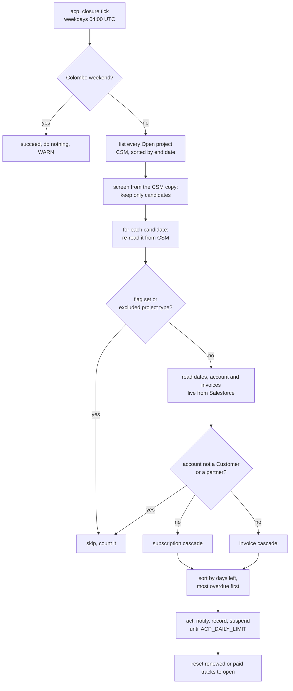

# ACP closure — how the sweep works

The Account Closure Process (ACP) as it runs in `csm-scheduled-tasks`: the
`acp_closure` sub-cron that warns customers before a project's subscription end
date or an unpaid invoice's suspend date, and suspends the project when the date
arrives. This page explains the run end to end. The operational settings and
review history live in the component's `CLAUDE.md` ("ACP closure"); the code is
in `internal/acp/`. The other sub-crons are covered in
[sub-crons.md](sub-crons.md).

**Status:** `acp_closure` replaces `integrations/acp-closure-service`, which is
frozen (it refuses to start unless it is a log-only dry run) and is deleted once
this task runs in production. Rule changes go to `internal/acp` only. The task
is off unless `ACP_ENABLED=true` and is a dry run unless `ACP_DRY_RUN=false`.

**Deploy order:** entity-service with the project `suspensionProcessOverridden`
flag and its migration must be live before this task runs. Without the flag in
the project read, every project is skipped (safe, and visible in the log).

## 1. A run at a glance

One invocation is one sweep. There is no long-running process: the platform
trigger supplies the cadence and the engine retries a failed run (section 7).

### Which projects are evaluated

The process this replaces only looked at some projects, so a project is read and
skipped (never a failure, never counted against the daily limit, one log line
with counts and no names) when:

| Skipped when | Decided from | If the data is missing |
|---|---|---|
| Its `suspensionProcessOverridden` flag is true | The fresh CSM read | Skipped too (fail closed), with a warning that entity-service did not return the flag |
| Its project type is evaluation subscription, cloud support, cloud evaluation support or internal | The fresh CSM read, before any Salesforce call | Evaluated |
| Its account status is not `Customer` | The live Salesforce account row | Skipped too (fail closed), counted separately |
| Its account is itself a partner (classification `Partner`) | The live Salesforce account row | Evaluated |

A partner account is skipped before either cascade. That is different from a
customer that *has* a primary partner, which the invoice cascade still handles
with its grace-period rule. `ACP_EXCLUDED_PROJECT_IDS` stays as the manual,
per-project exclusion. One difference remains: the earlier process evaluated
Open and Restricted projects, and the list here asks for Open only.

### Screening: look at few, confirm live

Every open project costs about six Salesforce-backed calls, so a full pass takes
tens of minutes. With `ACP_SCREENING` on (the default), a run first decides **who
to look at** from the CSM copy of the Salesforce data, and everything that
notifies or suspends still runs on the live read. A project is a **candidate** if
any of these hold:

- its CSM end date is missing, or within 91 days (past dates included);
- its saved process state records any non-`open` event on either track, so the
  renewal reset still runs for a project far from its end date;
- it owns, through its opportunity links, an unpaid invoice due within 91 days.
  This is safe because an invoice's suspend date is never earlier than its due
  date, so a suspend date within the horizon implies a due date within it.

The screen is a **superset** by design, and it **fails open**: if any of its reads
fails or is incomplete, every project goes through the live path that run, with
one warning. Screened-out projects cost no re-read and no Salesforce call, and
they never use the daily limit.

A stale copy can therefore make ACP late, never wrong: a candidate is confirmed
live before any notice or suspension. What the screen cannot see is an invoice
that never reached the CSM copy, or a Salesforce end date earlier than CSM's.
`ACP_SCREENING_FULL_SWEEP_WEEKDAY` (default Monday, Colombo time) runs every
project live that day, which bounds a missed event to about a week, and
`--run-now=acp_closure --full-sweep` does the same for one run. A single-project
run (`ACP_TEST_PROJECT_ID`) always goes live. `ACP_SCREENING=off` restores the
full pass every run.

### Repairing the CSM copy

The live pass already reads Salesforce for every candidate (and for every project
on a full-sweep day), so it can notice when CSM's copy of a value has drifted.
With `ACP_REPAIR` on (the default), ACP compares, **without any extra Salesforce
call**, what it just read with the copy it has, and for each record that
differs posts one synthetic event to entity-service's existing
`POST /salesforce/events` ingest, which re-fetches that record from
sales-entity-service and upserts it, behind its stale-version guard.

Only the fields ACP's decisions rely on are compared: the project's start and end
dates, the account's partner flag, and each invoice's due date, paid date and
invoice date (an invoice the copy lacks counts as drifted). Everything else is
ignored. The repair runs after the decision, so it never changes what a run does;
a failed post is logged and ignored; screened-out and filtered projects are never
compared; a dry run posts nothing and only counts. One event per record per run,
at most `ACP_REPAIR_MAX_EVENTS` (default 200, 0 is off) a run, and one INFO line
of counts by entity, never names or ids. `ACP_REPAIR=off` posts nothing.

What it cannot repair from here: the opportunity's stage and EULA fields and the
existence of a link (CSM's rows for them carry no Salesforce id to match on; an
invoice event makes entity-service ingest its opportunity inline), and the
account's status and primary partner (CSM's account read does not return them).

### Running without sales-entity-service reads

`ACP_SALES_ENTITY_READS=off` (default `on`) makes ACP read **nothing** from
sales-entity-service: no project, customer, contacts, linked opportunities,
opportunities or invoices. Every decision is taken from CSM's copy through
entity-service, with the reads ACP already had for CSM: the project's dates and
account, the account's people and flags, the contacts, the opportunity links,
opportunities and invoices. The account's life cycle is the one thing an account
read does not return, so ACP lists the accounts whose life cycle is Customer once
per run (`POST /accounts/search`, `lifeCycle` filter); an account not in that list
is not a Customer, and a list that cannot be read in full stops the run before
anything is sent. Primary-partner presence is entity-service's approximation (any
partner link), which can only make an invoice's suspend date later, never earlier.

The trade-off, plainly: **there is no live confirmation.** The decision is only
as good as the CSM copy. A stale or missing invoice, end date or partner flag can
send a wrong notice or a wrong suspension, which is exactly what the live read
exists to prevent. For that reason screening (nothing live to confirm), the weekly
full sweep and the repair of CSM's copy (nothing live to compare) are all disabled
in this mode, and a warning at startup says so. The filters (project type,
overridden flag, account status, partner account) still apply, from the CSM data.

The Salesforce `State__c` write of a suspension is a write, not a read, and stays,
so a real run still needs `ACP_SALES_ENTITY_*`. A dry run in this mode builds no
sales-entity-service client and needs none of those settings.

### Two systems, two jobs

| System | What ACP reads | What ACP writes |
|---|---|---|
| CSM (entity-service) | The list of Open projects, each project's closure states and `suspensionProcessState` (the record of notices sent) | Notice records; the closure state and suspension record (`PATCH /projects/{id}`) |
| Salesforce (sales-entity-service) | Project dates, account owner, renewal manager and technical owner, contacts, partner status, opportunities, invoices | `State__c = Suspended` on a suspension |

The two are written by ACP itself. Nothing syncs CSM to Salesforce.

## 2. The decision: one cascade, two anchors

Every cascade counts the days between now and an **anchor date** and fires on the
same thresholds: **90, 60, 30, 15, 7 and 0**.

| Cascade | Anchor date | Its own record of progress |
|---|---|---|
| Subscription end date | The project's end date | `based_on_subscription_end_date` in `suspensionProcessState` |
| Unpaid invoice | The invoice's suspend date (below) | `based_on_due_invoices` in `suspensionProcessState` |

The two cascades are independent: separate state, separate closure-state
dimension (`endDateClosureState`, `invoiceDueDateClosureState`).

How a cascade decides (`internal/acp/closure/decide.go`):

- Days remaining are rounded **up**, so a project is never treated as further
  out than it is.
- **0 or fewer days**: fire the day-0 window. Notify if no day-0 notice is
  recorded, and suspend. Suspension has no idempotency of its own here: the
  caller checks the closure state.
- **Otherwise** the narrowest window already reached and not yet recorded. Windows
  are thresholds, not exact days: a project that reaches 10 days with nothing
  recorded gets the 15-day notice, not the 7-day one, and the 7-day one when it
  reaches 7. Only the narrowest window reached is sent. Notices are never
  caught up after a pause.

### The invoice anchor

Only invoices that count are considered (`invoice_resolve.go`):

- The invoice's opportunity is `50 - Closed Won` and its EULA field is set and not
  `Customer contract`.
- The invoice has a due date, is unpaid, is not an excluded classification, is not
  the `Auto Created PS` placeholder, and is due on or after the project's start date.

The cascade is driven by the one eligible invoice with the **earliest due date**, not the earliest suspend date. With differing grace periods another invoice can have an earlier suspend date and still not drive the cascade. The suspend date of that invoice (`decide_invoice.go`):

| Case | Suspend date |
|---|---|
| EULA 3.4 or later, no primary partner | The invoice due date |
| EULA 3.3 or earlier, or the account has a primary partner (the 60-day grace period) | Invoice date + 60 days, unless the credit period (due minus invoice date) is already longer than 60 days, then the due date |

An account that is a partner **without** a primary partner skips the invoice
cascade entirely. An unset EULA version (0) never triggers the grace period on
its own.

## 3. Acting on a decision

Both cascades are built first, then run **most overdue first** (stable, so a tie
keeps the subscription cascade ahead of the invoice one). Once one cascade
suspends the project, the later cascade skips its **email**: the "already closed"
flag is tracked in memory, because a read of the project right after a write is
not guaranteed to show it.

A cascade whose **own track is not Open** (a person reopened the project and left
"Pending Suspended", "Notified" or similar behind) is left out entirely: no
notice, no record, no suspension, and it does not mark the project closed for the
other track. Otherwise the customer would be told the project is suspended while
the suspension itself is skipped.

Per cascade, in order, and a failure stops that project:

1. **Probe the record write.** The project's `suspensionProcessState` is written
   back unchanged. If CSM refuses it for the project's own reason (400, 404, 409,
   422) nothing is sent and the project is skipped. Without this, a project CSM
   refuses to record would get the same notice every weekday.
2. **Notify.** Send the notice for the window (section 4). An error stops the
   project before any suspension.
3. **Record the notice** in the cascade's section of `suspensionProcessState`:
   `actionSendEmailNotification` is `SUCCESSFUL` if delivered, `IGNORED` if not
   (for instance, every recipient was filtered out).
4. **Suspend**, on day 0 only (section 5).

Each record write replaces the whole `suspensionProcessState`, so each cascade
builds on the previous cascade's write, not on the snapshot read at the start.
Building both from the snapshot once let the second cascade reset the first one's
section.

### Renewal reset

After the cascades, a track whose own closure state is still Open and whose date
is **more than 90 days away again** (a renewal, or a paid invoice) has its saved
`event_type` set back to `open`, so the next term's reminders start over. It never
changes a closure state: reopening a suspended project is not done here
(section 8).

## 4. Notices

| Window | Internal (account owner, renewal manager, technical owner) | Customer |
|---|---|---|
| 90, 60, 30 | Yes | No |
| 15, 7, 0 | Yes | Yes |

- **Internal** subjects are `[ACP]`-prefixed: `[ACP] N Days Reminder of Project
  for <project> of <account>` and `[ACP] Project Suspension Notice of ...` on
  day 0. The invoice cascade uses invoice wording and lists every due invoice.
- **Customer** notices are never `[ACP]`-prefixed and never name the account.
  Future tense before day 0 (`Upcoming Project Suspension Notice`), past tense
  after. The invoice cascade sends a `Payment Reminder` instead.
- **Customer recipients** are the project's `BUSINESS_CONTACT` contacts. With none,
  the account's primary contacts. With neither, no customer notice goes out and an
  `[Urgent] [ACP] No Business Contacts Specified` nudge goes to the internal
  recipients instead.
- **Standing lists** (`ACP_STANDING_CC_RECIPIENTS`) are added to every notice.
  Leave them empty outside production. A customer notice that reaches only the
  standing lists is not counted as delivered.
- **Recipient filter**: addresses outside `@wso2.com` are dropped unless
  `ACP_ALLOW_NON_WSO2_RECIPIENTS=true` (production only). With no `to` left, the
  send is skipped.

## 5. Suspension

Suspension runs only if that cascade's own closure state is still Open, and writes
in this order:

1. **Salesforce first**: `State__c = Suspended`.
2. **One CSM `PATCH`**: the closure field and the suspension's record together.

| Cascade | Closure field written | Record written |
|---|---|---|
| Subscription end date | `endDateClosureState = Closed` | `event_type: suspend`, `suspended_on: <Colombo date>` |
| Invoice | `invoiceDueDateClosureState = Suspended` | the same, in the invoice section |

The day-0 notice is recorded as `suspend_notice`, which reads as window 0. A retry
therefore sends no second notice and only retries the suspension. `suspend` is
**never** written on its own: an Open project carrying a `suspend` record is how
entity-service's reopen recognises "a person set it back to Open", so writing it
early would reopen a project that was never suspended.

Consequences of the order:

- A Salesforce failure leaves CSM Open with `suspend_notice` only, and Salesforce
  untouched. The next run retries.
- A CSM failure after Salesforce succeeded leaves Salesforce Suspended and CSM
  Open until the next run retries (the Salesforce write is repeated, then the
  CSM one).

## 6. Safety switches

| Setting | Default | Effect |
|---|---|---|
| `ACP_ENABLED` | off | The task is not registered and no `ACP_*` setting is read |
| `ACP_DRY_RUN` | true (unset or malformed too) | Decide and log. Nothing written to CSM or Salesforce |
| `ACP_EMAIL_SEND_ENABLED` | false | Notices are only logged |
| `ACP_TEST_PROJECT_ID` | unset | Scope the run to one project |
| `ACP_EXCLUDED_PROJECT_IDS` | empty | Skip listed projects entirely. For verified business exclusions only, not for data bugs |
| `ACP_DAILY_LIMIT` | 0 (no cap) | Most projects one run acts on (sends or records a notice, or suspends), most overdue first. Skipped and screened-out projects do not count; reaching it is not a failure. A dry run counts the same way, so it shows what a capped real run would do. A malformed or negative value stops startup |
| `ACP_SCREENING` | on | Screen from the CSM copy and go live only for candidates. `off` evaluates every project live |
| `ACP_SCREENING_FULL_SWEEP_WEEKDAY` | Monday | The weekday (Colombo time) on which every project is evaluated live |

`--run-now=acp_closure` takes `--dry-run` (forces a dry run, and turns emails off
unless there is a debug list), `--limit=N` (can only tighten the configured limit)
and `--full-sweep` (evaluate every project live for this run).

Startup refuses combinations that would harm customers:

| Combination | Why it is refused |
|---|---|
| `ACP_DRY_RUN=false` without `ACP_EMAIL_SEND_ENABLED=true` | It would record notices nobody received and suspend customers who were never told. `acp.Run` refuses it again as a last guard |
| Dry run **with** emails on and no `debug` list | A dry run records nothing, so every run would resend every due notice |
| A `debug` list with `ACP_DRY_RUN=false` and no `ACP_TEST_PROJECT_ID` | Notices would reach only the testers while every project is recorded and suspended |

`ALERTS_ENABLED=false` turns the task into a dry run without emails instead of
refusing. A `debug` list for `acp_closure` in `SUB_CRON_RECIPIENTS` sends every
notice there as a `[Test copy]`.

## 7. Failures, retries and weekends

- **Fresh read.** Every open project is listed first, then re-read from CSM right
  before it is decided. A listing can be as old as the run, and every record write
  sends the whole state, so deciding from the listing could undo a concurrent
  change. The write is not conditional: entity-service has no version check on
  `PATCH /projects/{id}`.
- **The daily limit stops the run cleanly.** Once `ACP_DAILY_LIMIT` projects have
  been acted on, the rest are not evaluated, one line says how many, and the run
  succeeds. They are picked up by the next run, most overdue first.
- **Screening failing** is not a run failure: any unreadable or incomplete screening
  data sends every project through the live path that run (fail open), with a warning.
- **One project failing** does not stop the others, with one exception: a CSM
  write failure every project would hit (401, 403, 429, 5xx or no response) stops
  the run, since notices go out before they are recorded and carrying on would
  resend every one next time.
- **A project with an unusable record** (no Salesforce id, one Salesforce does not
  have, an unparseable date) is **skipped** with a warning and does not fail the
  run. No retry can fix it, and failing would alert every weekday.
- **A customer-window notice can half-succeed.** At 15, 7 and 0 days the internal notice and the customer notice are separate sends. If the internal one is delivered and the customer one fails, the record write is never attempted, so a retry sends the internal notice again.
- **Any other failure** makes the run return an error naming the run id and at
  most 20 project ids (never their errors, which can hold customer data). The
  engine alerts and retries after 4 hours, at most once a day (`MaxAttempts` 2).
  A retry repeats nothing already recorded, except a notice whose email went out
  while its record write failed, which is sent again.
- **Weekends.** The schedule is weekdays only. The handler also succeeds without
  doing anything on a Colombo Saturday or Sunday (for a retry that lands there),
  logging a warning. The one exception is `TRYOUT_TASK=acp_closure`, which bypasses
  the guard; with `ACP_TEST_PROJECT_ID` set and `ACP_DRY_RUN=false` a weekend tryout
  can write and suspend that project. Monday's run catches up, because windows and suspension are
  thresholds.

## 8. Reopening is a separate piece

`acp_closure` never reopens a project. A renewed or paid project stays suspended
until entity-service's ACP reopen (PR #3124) does it, driven by the
`acp_reopen_check` task, or someone does it by hand. That reopen only acts when entity-service has `CSM_ACP_REOPEN_ENABLED=true` and its reopen dry run (`CSM_ACP_REOPEN_DRY_RUN`) off; otherwise suspended projects are not reopened. entity-service keeps a copy of
the date and invoice rules, so a rule changed here must change there too:
`closure/rules_parity_test.go` and `sweep/rules_parity_test.go` run both over the
shared cases in `entity-service/internal/service/testdata/acp_rules_parity.json`.
A rule changed on one side only makes ACP suspend a project every day and the
reopen check reopen it.

## 9. Where things are

| Piece | Path |
|---|---|
| Task wiring, config, weekend check | `internal/acp/task.go`, `cmd/server/acp_config.go` |
| Sweep, listing, re-read, failure handling | `internal/acp/sweep/run.go` |
| Cascades, notices, record and suspension writes | `internal/acp/sweep/sweep.go`, `invoice_orchestrate.go`, `invoice_resolve.go` |
| Window and date arithmetic | `internal/acp/closure/` |
| `suspensionProcessState` reads and writes | `internal/acp/suspensionstate/` |
| Recipient resolution | `internal/acp/recipients/` |
| Email templates and sending | `internal/acp/notify/` |
| Salesforce reads and the `State__c` write | `internal/acp/salesentity/`, `sweep/salesforce_details.go` |
| The daily reopen driver | `internal/acp/reopen_check.go` |
| Screening from the CSM copy | `internal/acp/sweep/screen.go` |
| Selection filters, daily limit, run-now narrowing | `internal/acp/sweep/run.go`, `cmd/server/acp_config.go`, `cmd/server/runnow.go` |
