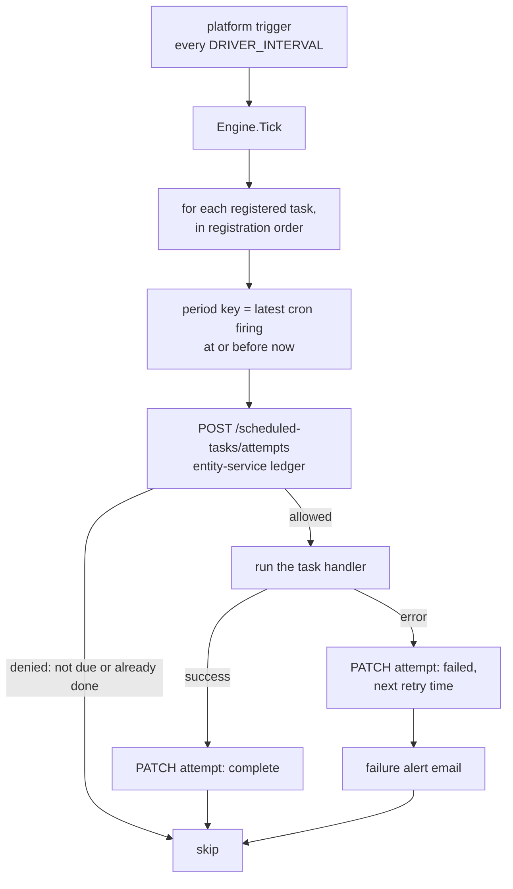

# Sub-crons: what each registered task does

`csm-scheduled-tasks` runs one tick per invocation and, on that tick, offers every
registered task to the engine. This page is the tour of those tasks: what triggers
each one, what it reads and writes, how it decides, and what happens when it
fails. The mechanism they all share (period keys, the run ledger, retries) is in
the component [README](../README.md#period-keys-retry-and-supersede). The
operational settings and review history are in the component's `CLAUDE.md`; the
code is in `cmd/server/main.go` (registration and defaults) and one package per
task under `internal/`.

The Account Closure Process has its own page, [acp-closure.md](acp-closure.md).
This page only summarises it.

Everything below was checked against the code. Where a task has no `CLAUDE.md`
section, the package's doc comments are the deepest source.

## 1. How a tick reaches a task

What every task inherits from the engine:

| Behaviour | Detail |
|---|---|
| Period key | The task's most recent cron firing. Every tick between two firings derives the same key, so retries land on one ledger row |
| Retry | A failed attempt is retried on the first tick after its retry time, which defaults to `DRIVER_INTERVAL` after the failure. There is no cap by default |
| Attempt cap | `MaxAttempts` is set on three tasks only: `time_card_report`, `acp_reopen_check` and `acp_closure` (2 each: one retry, because a retry can repeat something outward) |
| Abandonment | When the next period comes due while the old one is still unresolved, entity-service marks the old row superseded and only the new period is chased |
| Stale claims | The engine passes entity-service a stale-claim threshold of twice `DRIVER_INTERVAL`, after which a claimed attempt that never reported can be claimed again |
| Failure alerts | Every failed attempt emails the task's own `to` plus `ALERT_RECIPIENTS`, with the task's `cc`. `ALERTS_ENABLED=false` silences it |
| Order | Tasks due in one tick run in registration order. `acp_reopen_check` is registered before `acp_closure` on purpose |
| Overrides | Any task's schedule is replaced by its `SUB_CRON_SCHEDULES` entry, and its recipients come from its `SUB_CRON_RECIPIENTS` entry, both keyed by the exact task name |

The shipped handlers are written to be idempotent per period. How each one gets
there differs, and is stated per task below.

All schedules below are cron expressions evaluated in the process's local time
zone. With `TZ=UTC` set in the deployment (the documented setup) they are UTC.
Colombo is UTC+5:30 with no daylight saving.

## 2. Summary

| Task | Default schedule (UTC) | Registered when | Purpose |
|---|---|---|---|
| `housekeeping_cleanup` | `0 3 * * *` | Always | Delete old resolved ledger rows |
| `stale_cases_report` | `0 7 * * *` | Always (sends only with a `to`) | Email cases open for more than 30 days |
| `open_cases_report` | `0 8 * * *` | Always (sends only with a `to`) | Email cases still in Open that were created before yesterday |
| `migration_case_report` | `30 22 * * 0` | Always | Weekly scan of long-running migration engagements |
| `unresolved_products_digest` | `0 6 * * *` | Always (sends only with a `to`) | Email deployment nodes whose product is not in the catalogue |
| `cs_worklogs_daily_report` | `55 3 * * *` | Always | Yesterday's CS worklogs |
| `cs_worklogs_weekly_report` | `0 16 * * 1` | Always | The Monday to Sunday just gone, CS worklogs |
| `query_hours_usage_notifications` | `15 * * * *` | Always | Per-project query hour threshold crossings (75, 90, 100 percent) |
| `query_hours_weekly_report` | `0 4 * * 1` | Always | Weekly query hour consumption report |
| `product_regression_report_apim`, `_iam`, `_integration` | `30 3 1 * *` each | Always (send only with a `to`) | Last month's regression cases, one report per business unit |
| `time_card_report` | `30 5 2 * *` | Always (does nothing without `TIME_CARD_REPORT_PROJECT_KEYS`) | Mail each configured project's contacts last month's approved effort |
| `publish_scheduled_announcements` | `*/15 * * * *` | Always | Publish scheduled announcements that have come due |
| `cloud_status_webhooks` | `*/5 * * * *` | `CLOUD_STATUS_ENABLED=true` | Post service-status transitions to the public status dashboards |
| `availability_recalculation` | `0 3 * * *` | `AVAILABILITY_RECALC_ENABLED=true` | Trigger the service availability recompute |
| `usage_rollup_daily` | `30 0 * * *` | `USAGE_ROLLUP_ENABLED=true` | Rebuild recent daily usage rows |
| `usage_rollup_monthly` | `30 1 * * *` | `USAGE_ROLLUP_ENABLED=true` | Rebuild last and current month usage rows |
| `rota_weekday_reminder` | `30 9 * * 1-5` | `EMAIL_BASE_URL` set (scheduled sends also need the Rota Access switch) | Remind the next working day's rota people |
| `rota_weekend_notice` | `30 14 * * 0-4` | Same | Announce the coming weekend once it is fully marked |
| `rota_weekend_reminder` | `30 9 * * 5` | Same | Friday re-send of the weekend summary, with updates and cancellations |
| `rota_manual_reminder` | `*/5 * * * *` | Same | Fulfil "Send now" and "Send a test to me" requests |
| `case_autoclosure` | `30 2 * * *` | `AUTOCLOSURE_ENABLED=true` | Remind and close cases idle in Awaiting Info or Solution Proposed |
| `acp_reopen_check` | `30 3 * * *` | `ACP_REOPEN_CHECK_ENABLED=true` | Drive entity-service's daily ACP reopen check |
| `acp_closure` | `0 4 * * 1-5` | `ACP_ENABLED=true` | Account Closure Process: notices and suspension |

That is 26 registered names. Task names are API contracts: a rename orphans the
task's ledger history and stops matching any schedule or recipient override.

### Who gets what

Three audiences exist, and they are not the same thing:

| Audience | Source | Applies to |
|---|---|---|
| Failure alerts | `ALERT_RECIPIENTS`, plus the task's `SUB_CRON_RECIPIENTS` `to` and `cc` | Every task. Tasks that leave the ledger `to` empty by design (the migration scan, both CS worklogs reports, both query hour tasks, the three regression reports) alert `ALERT_RECIPIENTS` only, so a business-unit mail group is not told every hour that entity-service is down |
| Report readers | The task's own `SUB_CRON_RECIPIENTS` `to` and `cc`, sometimes merged with a derived list | The report tasks (sections 4 to 8) |
| People on the rota or the account | Derived from entity-service data | The rota reminders, query hour notices, ACP notices and the time card report |

A report task with no `to` skips its entity-service query and succeeds, except
where a section says it fails instead. `ALERTS_ENABLED=false` makes every report
task succeed without doing any work, and suppresses every email.

## 3. Ledger housekeeping

### `housekeeping_cleanup`

- **Triggers:** daily at 03:00.
- **Does:** `DELETE /scheduled-tasks/attempts?resolvedBefore=<cutoff>` on entity-service. It removes ledger rows that succeeded or were superseded before the cutoff, judged by their own resolution time. Failed rows that are still retrying are never touched, whatever their age.
- **Failure and idempotency:** a failed call is retried on the next tick. Deleting the same rows twice is harmless.
- **Config:** `HOUSEKEEPING_RETENTION_DAYS` (default 30, a plain integer).
- **Watch for:** a task removed from the registry while it has an open failed row leaves that row orphaned, because nothing ever supersedes it and this task never deletes open rows. It has to be resolved in entity-service by hand.
- **Detail:** `CLAUDE.md` "Housekeeping", `internal/housekeeping/`.

## 4. Case reports

The three tasks here and the digest after them share a shape: fetch from
entity-service, render with a template that task owns (`internal/notify`), send
from inside the handler. The engine never sends a success email on a task's
behalf.

### `stale_cases_report`

- **Triggers:** daily at 07:00.
- **Reads:** `GET /reports/long-open-cases?olderThanDays=30`. The 30-day window is a constant, not configurable. Which cases count, the split into two tables ("Ongoing cases" and "Ongoing cases on onboarding projects"), ordering and row caps all live in entity-service.
- **Sends:** one email to the task's `to` and `cc`. If both tables are empty it sends nothing, logs the counts and succeeds.
- **Fails when:** the fetch or the send errors (retried every tick). An entity-service without the endpoint answers 404, so deploy entity-service first.
- **Config:** `SUB_CRON_RECIPIENTS` (the audience), `CSM_PORTAL_WEB_BASE_URL` (case links; plain text when unset).
- **Detail:** `CLAUDE.md` "Stale cases report", `internal/stalecases/`.

### `open_cases_report`

- **Triggers:** daily at 08:00.
- **Reads:** `POST /cases/search` for cases whose state is exactly `open` and whose creation time is before the start of yesterday. The boundary is a UTC calendar day, independent of `TZ`.
- **Sends:** one email, oldest first, to the task's `to` and `cc`. The handler has no empty-result guard, so it sends even when the list is empty.
- **Fails when:** the search or the send errors.
- **Detail:** `CLAUDE.md` "Open cases report", `internal/opencases/`.

### `migration_case_report`

- **Triggers:** Sundays at 22:30 (Monday 04:00 in Colombo).
- **Reads:** `GET /reports/migration-cases?olderThanDays=N`. Three tables: engagements the customer asked to hold, ones waiting on the accounts team, and the rest.
- **Sends:** one email, always, empty tables included. The audience is the task's own `to` and `cc` merged with the team mail groups that entity-service derives from its team table, de-duplicated ignoring case with To winning over Cc.
- **Fails when:** the merged audience is empty. This one fails rather than skips, because a scan nobody receives looks exactly like a quiet week. It also fails on fetch or send errors.
- **Config:** `MIGRATION_CASE_REPORT_OLDER_THAN_DAYS` (default 180, startup refuses more than 3650), `MIGRATION_CASE_REPORT_LINK_BASE_URL` (https, optional).
- **Detail:** `CLAUDE.md` "Per-task report emails", `internal/migrationscan/`.

### `unresolved_products_digest`

- **Triggers:** daily at 06:00.
- **Reads:** `GET /instances/unresolved-products` for nodes seen in the last 24 hours whose product or version is not in the catalogue (a fixed window, tied to the daily schedule).
- **Sends:** one email to the task's `to` and `cc`. It sends nothing when the list is empty: the email exists to prompt an action, and a daily "nothing to do" would train readers to ignore it. A node stays listed every day until its catalogue entry exists, on purpose.
- **Fails when:** the listing or the send errors.
- **Detail:** `CLAUDE.md` "Unresolved products digest", `internal/unresolvedproducts/`.

### Failure and idempotency for the four

The send is the last step of the handler. A failure before it retries cleanly; a
success is recorded once for the period. The mails themselves are not safe to
re-trigger by hand: a manual run-now writes no ledger row, so the scheduled run
for the same period still fires and mails again.

## 5. CS worklogs reports

### `cs_worklogs_daily_report` and `cs_worklogs_weekly_report`

- **Trigger:** daily at 03:55 (09:25 in Colombo); Mondays at 16:00 (21:30 in Colombo).
- **Reads:** `GET /reports/worklogs` for a window derived in `Asia/Colombo`, never UTC and never the host zone: yesterday for the daily report, the Monday to Sunday just gone for the weekly one. The window comes from the **period key**, not the wall clock. A daily run that fails at 03:55 and succeeds after 18:30 UTC (already the next day in Colombo) would otherwise report the wrong day.
- **Sends:** one email per run, always, even when nobody logged time. The audience is configured (`SUB_CRON_RECIPIENTS` `to` and `cc`) by default. `WORKLOG_RECIPIENTS_SOURCE=derived` switches to the audience entity-service derives from the team registry. A drift line (counts only) is logged comparing the two.
- **Decision logic:** the configured lists are the default because the delivered mails are not reproducible from the team table: their To and Cc roles differ between the two cadences and some recipients hold no team membership.
- **Fails when:** the fetch or send errors, or the audience is empty. With the configured source and no `to`, the task skips and succeeds instead.
- **Config:** `WORKLOG_RECIPIENTS_SOURCE` (`configured` default, or `derived`; anything else refuses to start), `CSM_PORTAL_WEB_BASE_URL` (issue key links; https, plain text when unset).
- **On demand:** these two also accept an explicit window and a replacement audience (see the README sections on running a worklog report).
- **Detail:** `internal/worklogsreport/`, `internal/worklogreport/`.

## 6. Query hours

Both tasks share one entity-service client with a five-minute timeout, because a
recompute walks every opportunity in service and every project linked to each.

### `query_hours_usage_notifications`

- **Triggers:** hourly at minute 15.
- **Does:** `POST /query-hours/recompute`, which stores fresh figures and returns only the projects whose threshold state **rose** (to 75, 90 or 100 percent). The task mails one message per crossing to that account's manager and technical owner (internal addresses), Cc from `SUB_CRON_RECIPIENTS`.
- **Decision logic:** there is no stored per-project state on this side, so crossings are detected in process from the recompute's own response. An account with no internal owner is logged and skipped, not routed elsewhere. One failed mail does not stop the rest; the errors are joined.
- **Failure and idempotency:** the recompute writes before the mails go out, so a crossing whose mail failed is, from reading the code, not re-derived by the retry. That is an inference from the doc comments, not a tested behaviour. Treat a repeat run as non-idempotent.
- **Config:** `QUERY_HOURS_RECIPIENT_OVERRIDE` replaces every derived audience (for testing against real data without mailing real owners).

### `query_hours_weekly_report`

- **Triggers:** Mondays at 04:00.
- **Reads:** `GET /reports/query-hours`: accounts that exceeded their allowance or are close to it, plus the audience those accounts imply.
- **Sends:** one email, always, empty report included. The audience is derived (account managers and technical owners of the listed accounts, internal only) with the task's configured `to` and `cc` **added**, not substituted.
- **Fails when:** the fetch or send errors, or the resulting audience is empty.
- **Detail:** `internal/queryhoursreport/`, `internal/queryhours/`.

## 7. Product regression reports

### `product_regression_report_apim`, `_iam`, `_integration`

- **Triggers:** the 1st of the month at 03:30 (09:00 in India), each.
- **Reads:** `GET /reports/product-regressions?products=...`. The tag filter and the month window live in entity-service, which decides the month in `Asia/Colombo`, so a late retry still reports the same month.
- **Sends:** one email per report, grouped by product, to that task's own `to` and `cc` only. A month with no regression cases sends nothing.
- **Why three tasks:** one handler constructor runs over a variant (key, label, product list), registered three times so each report keeps its own schedule and recipients entry by exact name.
- **Fails when:** the fetch or send errors. With no `to` it skips.
- **Config:** `PRODUCT_REGRESSION_REPORT_PRODUCTS` (JSON object of variant key to product names, replaces the built-in lists; an unknown key or an empty list refuses to start), `PRODUCT_REGRESSION_REPORT_LINK_BASE_URL` (https, optional).
- **Detail:** `CLAUDE.md` "Monthly product regression reports", `internal/regressionscan/`.

## 8. Time card report

### `time_card_report`

- **Triggers:** the 2nd of the month at 05:30.
- **Reads:** for each key in `TIME_CARD_REPORT_PROJECT_KEYS`: `POST /projects/search` (the result whose key equals the configured one, ignoring case), `POST /projects/{id}/contacts/search`, and `GET /projects/{id}/time-cards/report` for the calendar month before the period key's month, UTC.
- **Sends:** **customer-facing.** One email per contact address (no Bcc exists, so no customer sees another's address), de-duplicated ignoring case, integration users left out. A month with no approved time is still sent, with a "no data" card. A project with no recipients is skipped with a warning.
- **Fails when:** any project fails. Projects are independent, and the run returns one error naming every failed project key.
- **Retry and idempotency:** the handler remembers nothing it sent, so a retry mails the projects that already succeeded again. The only brake is `MaxAttempts: 2`. To re-send one project, run it on demand with a project key.
- **Config:** `TIME_CARD_REPORT_PROJECT_KEYS` (empty or unset is a logged no-op). The task's `SUB_CRON_RECIPIENTS` `to` and `cc` are the failure-alert audience, never customer addresses.
- **Detail:** `CLAUDE.md` "Monthly time card report", `internal/timecardreport/`, `internal/timecards/`.

## 9. Publishing and status

### `publish_scheduled_announcements`

- **Triggers:** every 15 minutes.
- **Reads:** `POST /announcement-requests/search` for requests that are approved, scheduled, and whose publish time has arrived.
- **Writes:** `POST /announcement-requests/{id}/auto-publish` per due request. The fan-out (case creation, tagging, delivery) runs inside entity-service.
- **Decision logic:** every due request is attempted independently, so one stuck on a downstream outage does not delay the others. Errors are joined into one alert naming every request still stuck.
- **Idempotency:** a 409 (not fully delivered this pass) is expected: the request stays due and the next tick resumes from entity-service's own delivery ledger. This package keeps no state.
- **Needs:** this component's client id on entity-service's internal-caller list.
- **Detail:** `internal/announcementpublish/`.

### `cloud_status_webhooks`

- **Registered when:** `CLOUD_STATUS_ENABLED=true`. It is a paired cutover: leaving the legacy flow active at the same time would post every event to a public status page twice.
- **Triggers:** every 5 minutes.
- **Does:** in one tick, `POST /internal/cloud-status/sweep` (entity-service re-derives which transitions are owed), `GET /internal/cloud-status/pending`, then for each pending webhook an HTTPS `POST <dashboard base URL>/api/v1/webhook` with the configured signature header, and `POST /internal/cloud-status/{id}/delivery` to record the outcome.
- **Decision logic:** a sweep failure does not stop delivery of what is already recorded. Each webhook is attempted independently. A cloud with no configured dashboard URL, or an event entity-service sent without a wire value, is recorded as a failed delivery so it counts against entity-service's attempt limit instead of retrying forever.
- **Idempotency:** a delivered webhook leaves the pending set. If the post succeeds and recording it fails, it is posted again next tick: a duplicate on a status page is judged better than a missed one.
- **Config:** `CLOUD_STATUS_WEBHOOK_URLS` and `CLOUD_STATUS_WEBHOOK_SECRETS`, both JSON objects keyed by cloud slug. Startup refuses to run if either is empty or unparseable, because a bad map would burn the attempt budget and lose events silently. URLs must be https.
- **Detail:** `internal/cloudstatus/`.

## 10. Recompute triggers

These tasks decide nothing. The arithmetic runs in entity-service and the database,
because pulling the working set over HTTP every night is wasteful and this
component holds no database credentials.

### `availability_recalculation`

- **Registered when:** `AVAILABILITY_RECALC_ENABLED=true`. It writes a table that the legacy job also writes, with no unique key on the period, so enabling it is paired with switching the legacy job off.
- **Triggers:** daily at 03:00.
- **Does:** `POST /internal/availability/sweep` with a five-minute timeout.
- **Fails when:** the call errors, any subject failed (entity-service returns 200 on a partial sweep, so the handler checks the counts), or zero subjects were found, which is what an unmapped commitment table looks like. A quiet success on an empty sweep would hide that.
- **Idempotency:** a rerun recomputes the same periods. It rewrites rows, so the pairing rule above is what keeps it from doubling them.
- **Detail:** `CLAUDE.md` "Availability recalculation", `internal/availability/`.

### `usage_rollup_daily` and `usage_rollup_monthly`

- **Registered when:** `USAGE_ROLLUP_ENABLED=true` (both or neither), paired with switching off the legacy aggregation and its sync jobs, which write the same tables.
- **Triggers:** daily at 00:30 and 01:30.
- **Does:** `POST /instances/usage-rollups/daily` for each of the last `USAGE_ROLLUP_DAILY_LOOKBACK_DAYS` UTC days before today, newest first (default 2); `POST /instances/usage-rollups/monthly` for last month, then the current one. Today is left out of the daily run because ingestion keeps it current.
- **Decision logic:** the dates come from the **period start**, not the wall clock, so a retry after midnight or a month boundary rebuilds the days it was owed. One failing day or month does not stop the others; all failures are returned together and the whole run retries.
- **Idempotency:** high. A rerun over unchanged rows writes nothing, so the overlap between runs is free.
- **Detail:** `CLAUDE.md` "Usage rollups", `internal/usagerollup/`.

## 11. Rota reminders

Four tasks email the people rostered on a Team Schedule rotation, with calendar
invitations for their window. They are registered whenever `EMAIL_BASE_URL` is set,
but **nothing in this component's configuration turns them on**: scheduled sends
follow the switches saved on the Rota Access card in the portal. A family that has
never saved the card gets no scheduled reminder.

| Task | Default schedule (UTC) | Colombo | Announces |
|---|---|---|---|
| `rota_weekday_reminder` | `30 9 * * 1-5` | 15:00, Mon to Fri | The next working day's weekday rotations. Friday announces Monday |
| `rota_weekend_notice` | `30 14 * * 0-4` | 20:00, Sun to Thu | The coming weekend, once every shift meets its minimum. Until then the rota admins are asked each evening |
| `rota_weekend_reminder` | `30 9 * * 5` | 15:00, Fri | The weekend again: summary, invitations as updates, cancellations, gaps listed |
| `rota_manual_reminder` | `*/5 * * * *` | every tick | Requests queued by the card's "Send now" and "Send a test to me" |

- **Reads:** the catalogue (`GET /team-schedule/catalogue`), assignments (`POST /team-schedule/assignments/search` with absent people excluded by entity-service), the saved settings (`GET /team-schedule/reminder-settings/{family}`), the rota admins, and the weekend send record. The Team Schedule is internal-only, so this client's id must be on entity-service's machine-client list.
- **Writes and sends:** emails through the email service (one per weekday window; one weekend summary plus one invitation email per team per day), the weekend send record, and for manual requests a claim then a result per request.
- **Decision logic:**
  - The schedule decides only when a task runs. Which days it announces comes from the run's **period key** counted in `ROTA_REMINDER_TIME_ZONE`, so a retry announces what the scheduled run would have.
  - Settings saved on the card win: the weekday and weekend switches, invitation switches, per-rotation minimums and hours, copy lists. Nothing saved means no scheduled reminder, but Send now still goes out.
  - A weekend is announced only when every shift has its minimum people each day (`ROTA_REMINDER_WEEKEND_REQUIRED`). The notice is sent once and recorded; Friday compares its invitations with the recorded ones and cancels anybody taken off a window.
  - A window that has already started is not sent (a late retry).
- **Failure and idempotency:** the run fails only when no email went out, which repeats nothing. When some windows went out and others failed, the run succeeds and the handler itself emails the task's alert audience a "partly failed" notice, because the handler keeps no record of weekday sends and a retry would re-send every window. A failed settings read fails the run, so a reminder is never sent with settings somebody turned off. A manual request claimed but never reported is claimable again after 2 hours, so a crash can send its emails twice.
- **Config:** `ROTA_REMINDER_FAMILY`, `ROTA_REMINDER_WEEKDAY_SHIFTS`, `ROTA_REMINDER_WEEKEND_SHIFTS`, `ROTA_REMINDER_WEEKEND_REQUIRED`, `ROTA_REMINDER_WINDOWS`, `ROTA_REMINDER_TIME_ZONE`, `ROTA_REMINDER_INVITES_ENABLED` (needs `EMAIL_FROM_ADDRESS` as the organizer), `ROTA_REMINDER_SCHEDULE_URL`, `ROTA_REMINDER_COPY_TASK_RECIPIENTS`, `ROTA_REMINDER_REDIRECT_TO` (sends every reminder to a test inbox instead). A task's `SUB_CRON_RECIPIENTS` get its failure alerts, and are copied on emails only with the copy flag.
- **Detail:** `CLAUDE.md` "Rota reminders", `internal/rotareminder/`, `internal/teamschedule/`.

## 12. Case auto-closure

### `case_autoclosure`

- **Registered when:** `AUTOCLOSURE_ENABLED=true`. It comments on and closes customers' cases, so it is never on by accident. `AUTOCLOSURE_SCHEDULED=false` keeps it registered but off the schedule, so it runs only on demand.
- **Triggers:** daily at 02:30 including weekends (08:00 in India).
- **Does:** a trigger only. Eligibility, comment text, how a case is closed and the daily limit all live in entity-service. Each run works through four stages in order: `release_hold`, `close`, `second_reminder`, `first_reminder`. For each it asks `POST /autoclosure/candidates` what is due and `POST /autoclosure/cases/{id}/advance` per case. A case moves at most one stage per run. A stage listing is paged up to 20 passes.
- **Decision logic and safety:** a failure on one case never stops the others; a failed listing does not stop other stages. Cases that fail a stage three times in seven days are quarantined by entity-service and logged as a warning, without failing the run, so a permanent quarantine does not become permanent alert noise.
- **Failure and idempotency:** the run returns an error if anything failed, and the retry is safe: advanced cases are no longer due, each advance is a compare-and-set claim, and the day's limit is counted from entity-service's audit table.
- **Config:** `AUTOCLOSURE_INTERVAL_DAYS` (7), `AUTOCLOSURE_DAILY_LIMIT` (500, 0 for no cap), `AUTOCLOSURE_DRY_RUN`, `AUTOCLOSURE_STATES`, `AUTOCLOSURE_TEMPLATES`, `AUTOCLOSURE_SCHEDULED`. A malformed value refuses to start. A tryout of this task is always forced to a dry run.
- **Detail:** `CLAUDE.md` "Case auto-closure", `internal/autoclosure/`.

## 13. Account Closure Process

Two tasks, independent of each other. Both retry after 4 hours and at most once a
day (`MaxAttempts` 2).

### `acp_reopen_check`

- **Registered when:** `ACP_REOPEN_CHECK_ENABLED=true`. It needs entity-service with its ACP reopen enabled, or every run fails with a 404 (or 403 if this client is not on the machine-client list).
- **Triggers:** daily at 03:30 (09:00 in Colombo), every day including weekends, half an hour before `acp_closure`.
- **Does:** `POST /acp/reopen-check` page by page (5 projects a page, a 2-minute timeout per page) while the answer says more remain. entity-service reopens suspended projects whose renewal or payment an event missed, and finishes ones a person set back to Open. This task decides nothing and writes nothing itself; whether anything is written is entity-service's own dry-run setting.
- **Fails when:** a project in a page failed (the error names at most 20 project ids), a page errors or makes no progress, or more than 2,000 pages are needed.
- **Pairing:** turn it on together with entity-service's live reopen. With one side off, either a missed reopen is never retried or every run fails.

### `acp_closure`

- **Registered when:** `ACP_ENABLED=true`. A dry run unless `ACP_DRY_RUN=false`.
- **Triggers:** weekdays at 04:00 (09:30 in Colombo); the handler also succeeds without acting on a Colombo weekend.
- **Does:** lists every Open project, and per project reads Salesforce data, runs the subscription end date cascade and the unpaid invoice cascade (windows at 90, 60, 30, 15, 7 and 0 days), sends the notice, records it in CSM, and suspends at day 0.
- **Full detail:** [acp-closure.md](acp-closure.md), `CLAUDE.md` "ACP closure", `internal/acp/`.

## 14. Running a task outside the schedule

Two mechanisms exist, both documented in the [README](../README.md#debug-mail-mode-and-tryouts):

- **Tryout** (`TRYOUT_TASK`): runs one task's handler once, outside the ledger, and refuses unless that task has a `debug` list so nothing reaches the real audience.
- **Run-now:** runs one registered task once and exits, also without the ledger. Every report task accepts a replacement audience, the two worklog reports accept a window, and `time_card_report` accepts a project key and an explicit `to`.

Because neither writes a ledger row, the scheduled run for the same period still
fires. That is safe for tasks that are idempotent by design (the recompute triggers,
the rollups, `publish_scheduled_announcements`, `cloud_status_webhooks`,
`case_autoclosure`, the ACP tasks) and sends mail again for every report, digest and
`time_card_report`. When unsure, treat a task as not idempotent.
